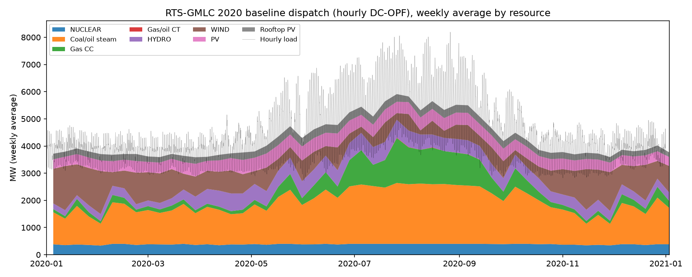
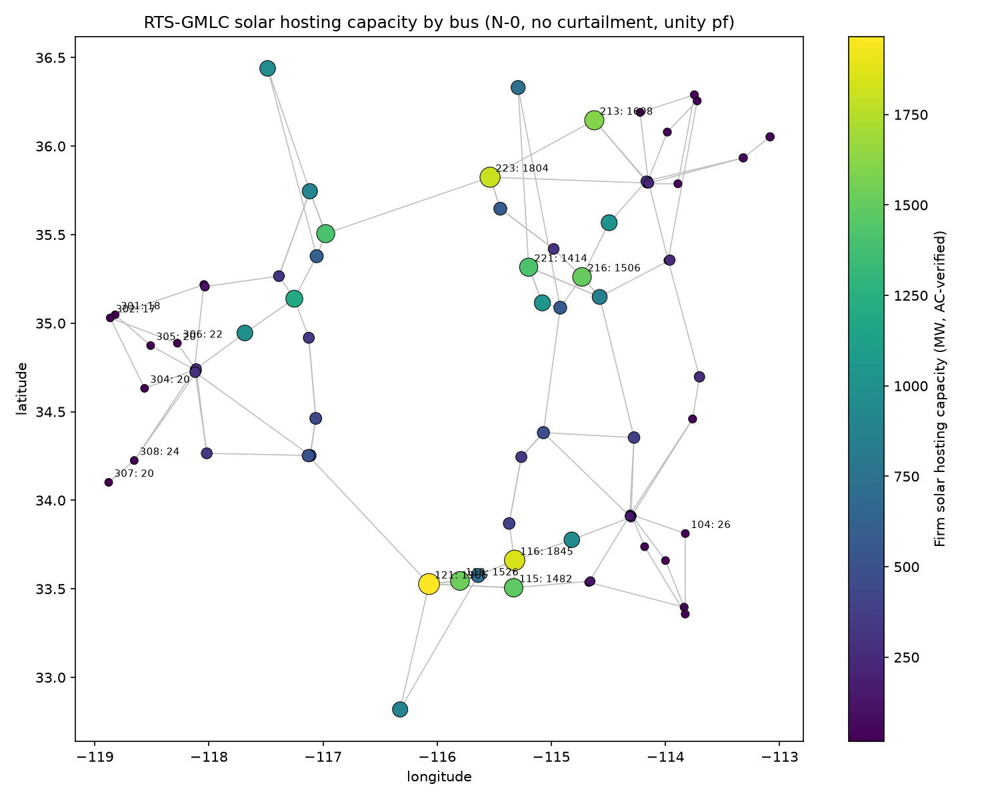
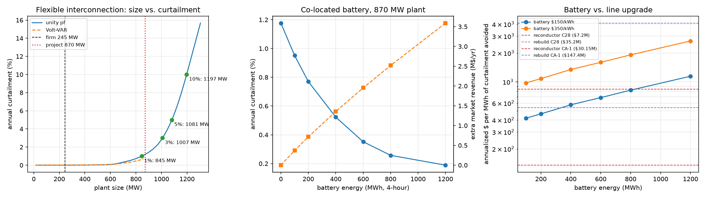
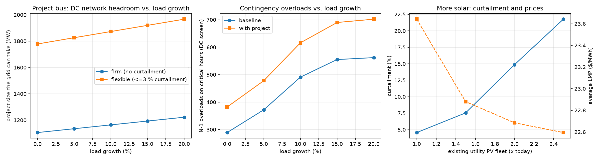

# Results

All numbers come from the scripts in `scripts/` (outputs in `results/`, figures in `figures/`).
System: RTS-GMLC (73 buses, 120 branches, 158 generators, 2020 hourly data, 8,784 hours).

## Phase 0: Python port validated against MATPOWER (5-bus)

The 24-hour, 5-bus study (fixed schedule vs. economic dispatch) was rebuilt in pandapower
and Pyomo/HiGHS. Over 48 hourly solutions it matches MATPOWER within **1.8e-10 pu** (voltage),
**5.4e-7 MW** (branch flow) and **$3e-6/h** (cost), i.e. the differences are CSV rounding. 20 tests.
Details: [phase0_results.md](phase0_results.md).

## Phase 1: 73-bus model, full-year baseline

**Validation against the MATPOWER reference output shipped with RTS-GMLC** (`results/phase1_validation.csv`):

| Check | Max difference | Reference precision |
|---|---|---|
| AC power flow, bus voltage | 4.8e-4 pu | printed to 3 decimals |
| AC power flow, branch P | 0.005 MW | 2 decimals |
| AC power flow, total losses | 0.005 MW (of 153.97) | 2 decimals |
| DC-OPF objective | $0.0014/h (of $225,806.07) | 2 decimals |
| DC-OPF LMP | 0.0007 $/MWh | 2 decimals |

Three modeling issues were found and fixed on the way (each changed results materially):

1. **Transformer tap side.** pandapower's MATPOWER converter puts the off-nominal tap on the HV
   side; MATPOWER applies it at the "from" bus (LV side here). Error before the fix (development run):
   0.037 pu max voltage difference vs. the reference.
2. **Hydro voltage control.** Hydro units have reactive capability in RTS-GMLC and must regulate
   voltage; modeling them as fixed injections (development run) left hydro buses near 1.11 pu.
3. **MW vs. MVA limits.** The DC-OPF limits MW while ratings are MVA, so DC-binding branches were
   above rating in AC. Each DC limit is derated by the branch's observed AC-MVA/DC-MW ratio
   (99th percentile on 600 stressed hours, cap 1.10; 15 branches derated, max factor 1.098).
   On the stressed hours, hours with an AC overload fell from **558 to 47 (-92 %)**. Branches that only
   become binding once a new plant is added are handled by an AC-to-DC feedback loop in the plant
   studies (Phase 2/4, below).

**Full-year baseline** (hourly DC-OPF dispatch + AC power flow; `results/phase1_summary.json`):

| Quantity | Value |
|---|---|
| Hours solved / AC converged | 8,784 / 8,780 |
| Runtime (DC-OPF + AC, 8,784 h) | 16.5 min (laptop) |
| Annual load / peak | 37.7 TWh / 8,192 MW |
| Annual production cost | $444.6 M |
| Average / 95th-percentile LMP | $23.64 / $28.51 per MWh |
| Hours with LMP spread > $1/MWh (congestion) | 2,991 |
| Renewable curtailment (PV, wind, hydro) | 4.56 % |
| Renewable share of load (incl. rooftop PV) | 43.7 % |
| AC losses | 2.70 % of load |

Baseline findings (properties of the test system with this dispatch, not of a new project):

- **Reactive-flow overload:** line C10 (306-310) is above its 175 MVA rating in 1,904 hours. Over the
  year it carries a median 72 MW but 162 MVA; in the overload hours, 108 MW at 182 MVA (about 146 Mvar).
  It needs voltage/reactive control, not more MW capacity.
- **Persistent overvoltage:** 138 kV buses 110/210/310 and 106/206/306 exceed 1.05 pu in 89-100 % of
  hours (35 hours have a bus above 1.10 pu); the data set has fixed voltage schedules and no switchable
  reactors.
- **Area-2 load pocket:** on summer peaks the cost-only dispatch turns off local plants; bus 207 drops
  below 0.95 pu in 553 hours and bus 208 in 469, and 4 peak hours (including the annual peak) do not
  converge at all (voltage-collapse risk). An operator would commit local units for voltage support
  (reliability-must-run).

## Phase 2: Solar hosting-capacity map (all 73 buses)

**Definition.** Network headroom at a bus in an hour = the largest zero-cost injection a DC-OPF can
accommodate by redispatching existing units within branch limits (OPF-based hosting capacity). Firm
capacity = largest plant whose output never exceeds the headroom (no curtailment), using the area's
hourly utility-PV shape, screened on about 890 critical hours per bus (sunniest, lowest net load, most
loaded relative to limits, random). AC verification with the redispatched fleet on the 12 tightest DC
hours, the 12 sunniest, the 12 lowest-net-load and the 12 highest-local-voltage sunny hours:

- **thermal:** a branch counts against the plant only if its distribution factor is >= 5 % (PJM/MISO
  convention) and the plant adds >= 5 % of its MW to the loading (>= 1 % of rating for a branch that is
  already overloaded). If such a branch is over its MVA rating while the DC-OPF holds it exactly at its
  MW limit, its DC limit is tightened by the observed MVA/MW ratio and the fleet is redispatched (up to
  3 times), as a security-constrained dispatch would; the plant fails only if redispatch cannot clear it;
- **voltage:** buses within 2 branches of the POI stay within 0.95-1.05 pu (or within 0.005 pu of the
  reference where the reference already violates);
- both are judged against a **superposition reference** (same redispatched fleet, plant MW taken by the
  system slack), which separates the plant's own effect from the market's redispatch.

| Result (`results/phase2_summary.json`) | Value |
|---|---|
| Firm hosting capacity, min / median / max | 17 / 276 / 1,966 MW |
| Median at 138 kV / 230 kV | 38 / 574 MW |
| Best vs. worst bus | 115x (bus 121: 1,966 MW; bus 302: 17 MW) |
| Limited by voltage / AC thermal / DC thermal | 75 % / 14 % / 11 % of buses (55 / 10 / 8) |
| Buses where the AC check lowers the DC result | 65 of 73 (median -86 %) |

**Takeaways.** (1) A DC-only screen overstates hosting capacity: the DC median (1,163 MW) is 4.2x the
AC-verified median (276 MW), and bus by bus the overstatement is 1-37x (median 5x).
(2) The binding issue at most buses is voltage rise at light load (reactive control), not thermal
capacity; 35 buses are limited by their own bus voltage (see Phase 4b).
(3) The firm values are a screen on critical hours, i.e. an upper bound: at the case-study bus the
full-year AC check gives 245 MW vs. 436 MW from the critical hours.

## Phase 3: Automated N-1 contingency screening

Critical hours (peak load, lowest net load, most loaded relative to limits, sunniest) x 118
non-islanding branch outages; 4 peak hours whose intact system does not converge are reported
separately. 42 hours, 4,956 AC power flows per case. Criterion: post-contingency loading <= long-term
emergency (LTE) rating.

| Screening method (baseline case) | Threshold | AC runs | Overloads found | Recall | Speed-up vs. full AC |
|---|---|---|---|---|---|
| Full AC (benchmark) | - | 4,956 | 921 | 100 % | 1x (138 s) |
| DC (LODF) | 100 % | 306 | 227 | 24.6 % | 14.0x |
| DC (LODF) | 85 % | 758 | 312 | 33.9 % | 6.2x |
| **Hybrid (LODF + base-case Q)** | **95 %** | **1,219** | **912** | **99.0 %** | **3.8x** |
| Hybrid | 90 % | 2,156 | 920 | 99.9 % | 2.3x |

- A pure DC screen misses three quarters of the AC overloads, because 716 of the 921 are on the
  reactive-loaded line C10. Adding each branch's intact-system reactive flow to the DC post-contingency
  MW (S ~ sqrt(P_post^2 + Q_base^2)) recovers 99.0 % at 3.8x speed (99.9 % at 2.3x).
- **With the 870 MW project at bus 320** (Phase 4): 993 overload cases vs. 921. **157 new** (10 of them
  did not converge without the project) and 85 that leave the list: 42 genuinely relieved and 43 that no
  longer converge in AC, so part of the net +72 reflects non-convergence. The largest new group (78 of
  157) is on line **C28**, after outages of C35, CA-1, C18, C19 or C23; next CB-1 (21). The worst
  post-contingency loading falls from 171 % to 156 % of LTE (the plant relieves the most stressed case)
  while more branches (23 vs. 21) are pushed over their LTE rating.
- 202 contingency cases (4.1 %) do not converge in AC in the baseline, 250 (5.0 %) with the project:
  candidate voltage-collapse contingencies for a continuation power flow study. The hybrid screen at
  95 % flags 172 of the 202 (85 %).

## Phase 4: Mitigations for an 870 MW solar project at bus 320

Project selection rule (fixed before looking at results): sunniest area (area 3, 28 % capacity factor),
POI limited by a branch thermal rating with firm capacity 50-500 MW (candidates 319 and 320; the rule
takes the upper median, bus 320, 230 kV), size = about 2x the screened firm capacity (436 MW), rounded
to 10 MW = 870 MW. Hourly headroom was computed for the **whole year**: DC for 8,784 h, AC-verified for
all 4,166 sunny hours and exact for any plant up to 1,305 MW (1.5x the project).

| Case | Plant size | Annual curtailment | Delivered energy |
|---|---|---|---|
| Firm interconnection (full-year AC) | 245 MW | 0 % | 0.60 TWh |
| **Flexible interconnection** | **870 MW** | **1.18 %** | **2.11 TWh (+251 %)** |
| Flexible, <= 1 % / 3 % / 5 % curtailment | 845 / 1,007 / 1,081 MW | | |

Curtailed energy by limiting element: voltage at buses 325 / 320 / 312 = 13,580 / 6,032 / 618 MWh
(80 %), thermal C28 4,794 MWh (19 %), AC non-convergence 134 MWh.

**Options to recover the curtailed energy** (annualized at 7 %, 20 years). Each option is evaluated alone
against the unity-pf base case; a combined Volt-VAR + reconductor case was not run, so the recoveries
cannot simply be added.

| Option | Capex | Curtailment | Recovered MWh/yr | $ per recovered MWh |
|---|---|---|---|---|
| **Inverter Volt-VAR (IEEE 1547 Cat B)** | settings change | **0.75 %** | **9,217** | about 0 |
| Reconductor C28 (16 mi, 500 -> 675 MVA) | $7.2 M | 0.94 % | 5,024 | **$135** |
| Rebuild C28 (-> 1,000 MVA) | $35.2 M | 0.89 % | 6,154 | $540 |
| Reconductor CA-1 (67 mi) | $30.2 M | 1.02 % | 3,389 | $840 |
| Battery 25 MW / 100 MWh (capture mode) | $15 M at $150/kWh | 0.95 % | 4,823 | $418 |
| Battery 100 MW / 400 MWh (capture mode) | $60 M at $150/kWh | 0.52 % | 13,979 | $577 |
| Battery 300 MW / 1,200 MWh (capture mode) | $180 M at $150/kWh | 0.19 % | 21,121 | $1,145 |

"Capture mode": the battery charges only from solar the grid cannot take that hour, so its benefit is
pure curtailment recovery (an arbitrage run is reported separately).

- **The cheapest fix is a control setting.** Because 80 % of the curtailment is voltage-driven,
  Volt-VAR recovers 9.2 GWh/yr (-37 % curtailment) for essentially no capital. It improves 171 hours but
  makes 132 hours worse (spot checks: absorbing VARs adds MVA on C28, or injecting VARs lifts a
  neighbour's voltage), and its worst hour cuts the curtailment-free (firm) size to 20 MW. A practical
  scheme would switch to unity power factor in those hours.
- **Among the capital options, reconductoring C28 is cheapest:** $135 per recovered MWh, 3x cheaper than
  the cheapest battery ($418/MWh at $150/kWh) and 4x cheaper than the 100 MW battery that reaches lower
  curtailment. The thermal part of the curtailment is small, so on its own the line upgrade recovers less
  than Volt-VAR does on its own.
- **Batteries of 100 MW or more** recover the most energy but cost $577-1,145 per MWh even at $150/kWh
  (smaller ones recover less than Volt-VAR). With prices
  averaging $23/MWh at the POI, a battery allowed to time-shift all solar (arbitrage) earns $2.0 M/yr
  extra at 150 MW / 600 MWh and breaks even only below about $22-27/kWh installed. The battery case is
  weak here because curtailment is small (1.18 %) and price spreads are narrow.
- An earlier version of this study (a 740 MW project, before the AC-to-DC feedback was added) blamed
  71 % of the curtailment on C28 and gave reconductoring $41.5/MWh. An independent code review showed
  that most of that "thermal" limit was a MW-vs-MVA artifact of the DC dispatch, which redispatch removes;
  part of the change in numbers also comes from the larger project size.

## Phase 4b: Volt-VAR where the plant raises its own bus voltage

35 of the 73 buses (22 at 138 kV, 13 at 230 kV) were limited in Phase 2 by the plant raising the voltage
of its own bus. The Phase 2 study was rerun at those buses with the new plant on the IEEE 1547-2018
Category B Volt-VAR curve (inverter rated 1.1 x plant MW so 0.44 pu reactive power is available at full
output):

| Result (`results/phase4b_summary.json`) | Value |
|---|---|
| Buses improved by more than 10 % | 32 of 35 (none worse) |
| Median firm hosting capacity, unity pf -> Volt-VAR | 65 MW -> 468 MW (median per-bus gain +388 %) |
| Total firm capacity added (each bus alone) | +12.2 GW |
| New binding limit after Volt-VAR | thermal at 22 buses, voltage (mostly a neighbouring bus) at 13 |

Volt-VAR is a near-zero-cost lever that multiplies firm capacity wherever the limit is the plant's own
voltage rise (other mitigations were not evaluated at these buses). Where the limit is thermal or a neighbour's voltage, its effect is small or
mixed (Phase 4). The right control depends on what limits the POI.

## Phase 5: Sensitivities (full-year DC-OPF reruns)

| Scenario | Production cost | Avg LMP | Hours with a binding branch (DC) | Renewable curtailment | N-1 overloads (DC screen, baseline / with project) |
|---|---|---|---|---|---|
| Base | $444.6 M | $23.64 | 3,523 | 4.56 % | 289 / 382 |
| Load +10 % | $538.0 M | $24.84 | 3,681 | 3.82 % | 491 / 616 |
| Load +20 % | $636.2 M | $25.97 | 3,845 | 3.30 % | 562 / 702 |
| Utility PV x1.5 | $414.5 M | $22.88 | 3,668 | 7.54 % | 192 / 280 |
| Utility PV x2 | $406.0 M | $22.68 | 3,699 | 14.86 % | 204 / 315 |
| Utility PV x2.5 | $401.9 M | $22.59 | 3,697 | 21.77 % | 205 / 317 |

- **Load growth** raises contingency risk fastest: +20 % load nearly doubles the N-1 overload cases on
  the critical hours (DC screen; +94 % in the baseline, 289 -> 562; +84 % with the project, 382 -> 702),
  while the project bus's DC network headroom grows 10.5 % (more local load to serve).
- **Diminishing returns of solar:** going from 1x to 2.5x utility PV cuts production cost only 9.6 % because
  curtailment rises from 4.6 % to 21.8 %, a clear case for storage or transmission at system level.
- **Battery break-even vs. reconductoring C28** ($135 per recovered MWh): a capture-mode battery would have
  to cost $48.6/kWh (25 MW / 100 MWh) down to $17.7/kWh (300 MW / 1,200 MWh) installed to compete, i.e.
  3-25x below the $150-450/kWh range considered. The ranking holds for any plausible battery price.

## Limitations

- No unit commitment (thermal units 0..Pmax with convexified costs); no reserves; one weather year.
- DC-OPF dispatch with an MVA calibration and AC-to-DC feedback, not a full AC-OPF; fixed generator
  voltage set-points; plants keep regulating voltage at 0 MW with the full Q range of all units at the
  bus (optimistic reactive support); no switchable shunts. These drive the baseline voltage findings.
- The voltage criterion (0.005 pu tolerance beyond an already-violating reference) is tight; the
  full-year firm value at the case-study bus is set by one near-collapse summer hour.
- The Phase 2 map is screened on critical hours (an upper bound); the case-study bus was checked for the
  full year (436 -> 245 MW). N-1 covers 42 critical hours, not 8,784.
- LMPs for the battery value are the baseline LMPs (no price feedback from the new plant). Line costs
  have no O&M; batteries have no degradation or augmentation.
- Costs are planning-level per-mile values; real upgrades depend on terminal equipment, sag and permitting.

## Cost and data sources

- Reconductor / rebuild cost per mile: MISO Transmission Cost Estimation Guide (MTEP22) as tabulated in
  the Illinois Power Agency "Cost Estimate Assumptions" workpaper (Feb 2024): 138 kV reconductor
  $0.37 M/mile, rebuild $1.7 M/mile; 345 kV $0.59 M / $3.2 M. 230 kV values are an assumption between
  the two ($0.45 M / $2.2 M); linear interpolation in kV would give $0.47 M / $2.37 M (C28 reconductor
  about $141 instead of $135 per MWh; no ranking changes). Reconductoring assumed sufficient up to
  135 % loading (same source).
- Battery: fixed O&M 4 % of capex per year and 85 % round-trip efficiency from NREL ATB 2025. Installed
  cost is swept ($150-450/kWh) instead of fixed, because no single defensible point value was confirmed.
- Network and time series: RTS-GMLC (GridMod/RTS-GMLC on GitHub).
