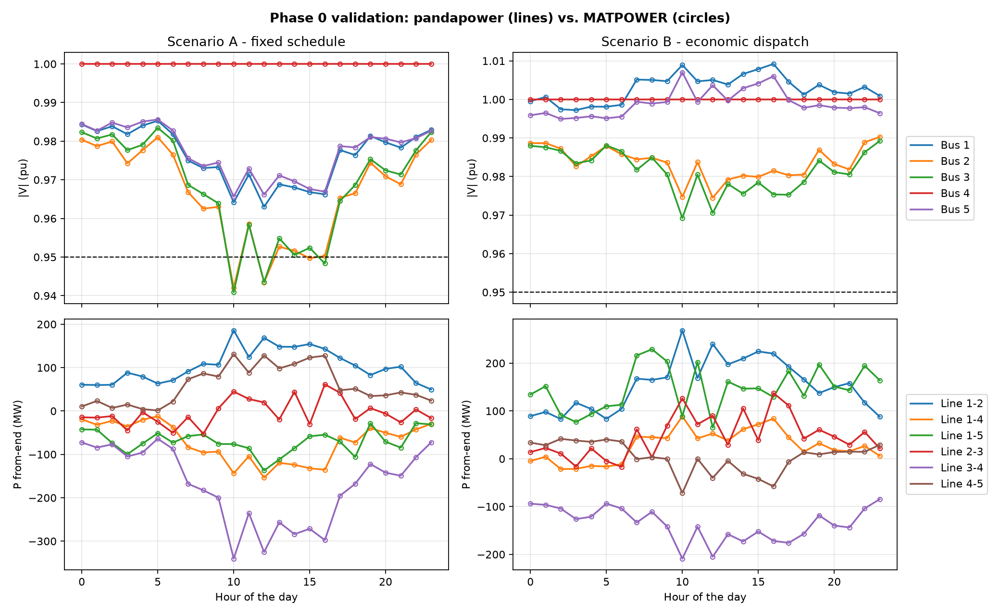

# Phase 0 — Python port and validation (5-bus, 24 h)

## What was done

The 24-hour AC power-flow study on the 5-bus system (MATPOWER `case5`, slack at bus 4, other
buses PQ, branches rated 400 MVA, linear generator costs) was rebuilt in Python:

- **Network:** pandapower, with branch per-unit data converted to ohms and nF so the pi model is
  identical to MATPOWER's (`src/gridstudy/networks.py`). Generators at PQ buses are fixed P/Q
  injections (`sgen`); the slack generator is an `ext_grid`.
- **Scenario A, fixed schedule:** G1/G2/G3/G5 = 20/100/50/200 MW with Qg = 0; the slack balances
  load and losses.
- **Scenario B, economic dispatch:** an hourly lossless LP in Pyomo/HiGHS (slack capped at 300 MW,
  Pmin = 0), Q at 0.95 pf, then an AC power flow in which the slack covers the losses. The LP is
  checked against the closed-form merit order and returns λ as the dual of the power-balance
  constraint.
- **Validation:** every hour compared with the MATPOWER 8.1 results (`scripts/phase0_reproduce.py`,
  `tests/test_phase0.py`).

## Validation result

| Quantity | Max abs. difference, A / B | Reference range |
|---|---|---|
| Voltage magnitude | 1.7e-10 / 1.8e-10 pu | 0.941 – 1.009 pu |
| Voltage angle | 8.4e-9 / 6.2e-9 deg | −5.9 – 1.5 deg |
| Branch P (both ends) | 5.4e-7 / 5.4e-7 MW | −340 – 345 MW |
| Generator P (A / B) | 4.5e-7 / 3.3e-7 MW | up to 875 MW |
| Generator Q (A / B) | 1.1e-6 / 1.1e-6 MVAr | up to 475 MVAr |
| Losses | 1.5e-8 / 1.1e-8 MW | 0.48 – 7.55 MW |
| Hourly cost | < $3e-6 | $6.4k – $34.5k |

The remaining differences are at the level of the CSV rounding in the reference files: the
models are numerically identical. 48/48 power flows converge (about 0.4 s per 24-hour scenario
without numba). The dispatch LP matches the merit order exactly (0.0 MW difference).

## Headline numbers (carried over from the 5-bus study)

| | A: fixed schedule | B: economic dispatch | Change |
|---|---|---|---|
| Daily cost | $531,714 | $342,309 | −35.6 % |
| Daily losses | 61.83 MWh | 43.87 MWh | −29.1 % |
| Voltage violations (< 0.95 pu) | 6 bus-hours | 0 | −100 % |
| Lowest voltage | 0.9409 pu | 0.9693 pu | +0.028 pu |
| Max branch loading | 389.4 MVA (97 %) | 288.5 MVA (72 %) | −26 % |

## Resume line (Phase 0)

> Re-implemented a 24-hour AC power-flow and economic-dispatch study in Python (pandapower,
> Pyomo/HiGHS); validated against MATPOWER to within 2×10⁻¹⁰ pu and 10⁻⁶ MW across 48 hourly
> solutions, with 20 automated tests.
